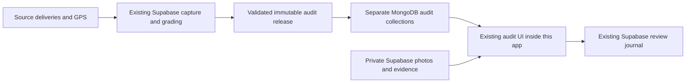

# Driver audits from the existing reporting system

This is a disabled release candidate. Merging to `main` deploys production. Do not merge, enable imports, activate grading schedules or publish a report without separate release approval.

## What moves, and what stays authoritative

The reporting system continues collecting and grading in its existing Supabase-backed workflow. This app imports the complete verified report package into three dedicated MongoDB collections: `driverAuditObjects`, `driverAuditReleases` and `driverAuditControl`. It does not modify operational deliveries, assignments, vehicles, users, KPIs, photos or timestamps.

The imported package contains the current report, original findings, retained history references, GPS evidence, renderer and immutable file identities. Reports → Open driver audits opens the existing audit interface at `/api/reporting/view` on this app's own origin.

### Placement and new arrivals

| Existing area | Integration boundary |
| --- | --- |
| `/reports` | Keeps the existing Reports & Analytics screen; adds one Open driver audits link. |
| `/driver-audits` | New Reports-permission entry that establishes the staff audit session. |
| `/api/reporting/view` | Dedicated audit document using the original reporting design. |
| Dashboard, deliveries, drivers, fleet, bags, Customer Service, partner/member pages | Existing components, routes and navigation are retained. |
| `/api/reports`, `/api/auth`, `/api/customer-service`, `/api/staff-reporting` | Existing handlers remain separate from the audit routes. |

The candidate includes the Customer Service merge already on `main`; it must not revert or replace that page. Its new audit route is additive.

The offline worker excludes audit documents, sessions, API responses and evidence assets. The Reports client checks the active worker before starting a new audit session. An older worker must update before the app issues a session. Activation clears only audit cache entries.

The direct import uses an owner-approved private handoff and runs with the old publication importer off. The supervised sync worker reads saved source evidence once per minute, pins a coherent source revision for each build, and stages newer arrivals on a later run. The browser defers reload while a review has an unsaved draft, is being saved, or an export is running. Failed updates retain the prior report. The audit shows the latest observed delivery capture, the visible cutoff and any blocked update.

Incoming evidence first passes through the existing Supabase-backed capture, recovery and grading pipeline. Any schedule change requires separate approval. The sync follows the saved feed and reports pending evidence and failures within the current allowances.

Large original photographs and retained evidence remain in private Supabase storage and are read through the authenticated server using their verified hashes. This avoids duplicating the full archive into the limited MongoDB allowance. Review responses continue to append to the existing Supabase journal; there is one authoritative review history, not two independently editable copies. Model proposals remain separate from original accepted grades and incident tiers.

## Runtime configuration

All configuration is server-only. No credentials belong in React configuration, Git, logs or the browser.

- `DRIVER_AUDIT_ENABLED=1`: explicitly enable the integration. Absent/off returns unavailable and makes no import calls.
- `DRIVER_AUDIT_ORIGIN`: exact origin, HTTPS in a hosted environment. Loopback HTTP is accepted for local acceptance only.
- `DRIVER_AUDIT_SUPABASE_SECRET`: existing reporting project server credential, supplied privately. The runtime is pinned to the existing reporting Supabase project.
- `DRIVER_AUDIT_CAPACITY_BYTES`: explicit reporting-copy allowance, at most 256 MiB. Includes object bytes plus 1 KiB per object; MongoDB index and control-document overhead must also be included in deployment sizing. No value is silently created or raised.
- `DRIVER_AUDIT_IMPORT_ENABLED=0` for a direct seed and supervised sync. The older publication-pointer mode uses a different revision sequence and requires a separate transition.
- Existing `JWT_SECRET` and staff authentication are reused. Reports permission and active staff status are rechecked on every request. Drivers/partners/members do not inherit audit access. Viewer role cannot save findings.

The client build must target the same origin (`REACT_APP_API_URL=/api` for local acceptance). Do not use the old port-5000 development override with a separate audit origin.

## Transfer and recovery

The source pointer identifies one immutable release. Before activation, the importer verifies every transferred chunk and core or deferred file, verifies the report identity and reads the imported package back. Activation compares against the prior pointer. The direct sync keeps its collector revision separate from the older publication-pointer sequence.

An interrupted import is resumable. A repeated identical revision is a no-op. Bad hashes, missing files, source errors, storage exhaustion and older/conflicting revisions leave the previous report selected. The response header `X-Audit-Import-Status` and authenticated status JSON (`auditImport`) distinguish checking, failure and success. Once a report is active, imports run without holding up the current report or review saves. Photo/asset reads and review writes do not initiate transfers. A failed or incomplete refresh retains the saved report and sets the existing status error, so the UI cannot treat it as a successful new refresh. First-load requests still wait for a verified package. An unresolved write keeps its storage reservation; do not reset capacity counters to hide an ambiguous write.

The importer transfers at most 128 MiB per attempt. Photos are not part of the MongoDB replication. The compressed package limits are unchanged; the GPS index decoder alone permits up to 256 MiB, because the saved current index exceeds the previous 128 MiB decoded limit. Measure process memory with the complete dataset before enabling additional PM2 processes.

Enabled imports reserve against the existing reporting reader allowance and meter transferred bytes before settlement. They do not create another financial pool or consume the collection allocation. Denied admission does not read source objects; uncertain failures retain the reservation. Internal estimates remain distinct from provider bills.

The renderer uses `/api/reporting/*` for the document, data and font requests, and the audit `/api/session` handshake. The existing proxy already forwards these requests. The renderer's package paths and hashes stay intact. All report responses remain authenticated, private and non-cacheable by shared caches.

## Verification and release

Code-only runtime files are copied deterministically from the private reporting repository with `scripts/export-audit-runtime.mjs`. `server/vendor/driver-audits/runtime-manifest.json` records each copied file's SHA-256. The reporting builder uses a separate `--private-builder` export. Keep that export, release files, and evidence out of the app Git repository. The private handoff pins the builder file hashes for sync startup.

Local acceptance must cover the real saved package imported into isolated MongoDB, repeat/interrupted/failed imports, staff permissions and revocation, real photo hashes and model-result bindings, visible GPS and honest unmatched assignments, original grade/tier/history preservation, failed-save draft retention, retry/reload and logout. A local test account and local copied review journal must never write acceptance notes into the real journal.

Use the reviewed application commit and GitHub's production gate. Merging to `main` deploys code. Audit activation requires the explicit workflow operations below.

1. Prepare the pinned private handoff in the reporting workspace with `scripts/prepare-driver-audit-handoff.mjs`. Run `--plan` before the approved `--apply`. The latter verifies archive dependencies and produces a content hash for the private handoff. Keep the config, receipts, packages and validation journals outside Git.
2. Set the dedicated `DRIVER_AUDIT_SUPABASE_SECRET` in the GitHub production environment. Run `audit-preflight` with the exact reviewed main SHA, handoff hash and approved replica capacity. Review host resources, MongoDB access and the exact dry-run import.
3. Run `audit-seed-enable` with the same inputs. Verify Maps origin, staff entry, a known photo and GPS trail, saved findings after reload, signed-out denial and the ordinary Reports path.
4. Run `--prepare-sync` with the same private handoff configuration to stage the full worker baseline under the original handoff hash. Use the staff acceptance receipt and measured host memory and disk requirements for `audit-sync-start`. A healthy process proves supervision. Verify a new saved delivery, photo, GPS update and completed grade reaching the live audit before reporting a working sync. The initial target is 30 minutes from saved evidence to visible report.

Use `audit-rollback` to stop the worker and disable audits. Preserve the original archive, review journal and model receipts. Qualify replica reclamation against verified private restore copies before enabling it.
