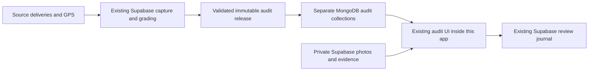

# Driver audits from the existing reporting system

This is a disabled release candidate. Merging to `main` deploys production. Do not merge, enable imports, activate grading schedules or publish a report without separate release approval.

## What moves, and what stays authoritative

The reporting system continues collecting and grading in its existing Supabase-backed workflow. This app imports the complete verified report package into three dedicated MongoDB collections: `driverAuditObjects`, `driverAuditReleases` and `driverAuditControl`. It does not modify operational deliveries, assignments, vehicles, users, KPIs, photos or timestamps.

The imported package contains the current report, original findings, retained history references, GPS evidence, renderer and immutable file identities. Reports → Open driver audits opens the existing audit interface at `/driver-audit-view` on this app's own origin. It is not a link or frame to an external reporting website, and it does not reimplement the audit design or map.

### Placement and new arrivals

| Existing area | Integration boundary |
| --- | --- |
| `/reports` | Keeps the existing Reports & Analytics screen; adds one Open driver audits link. |
| `/driver-audits` | New Reports-permission entry that establishes the staff audit session. |
| `/driver-audit-view` | New dedicated audit document using the original reporting design. |
| Dashboard, deliveries, drivers, fleet, bags, Customer Service, partner/member pages | Existing components, routes and navigation are retained. |
| `/api/reports`, `/api/auth`, `/api/customer-service`, `/api/staff-reporting` | Existing handlers remain separate from the audit routes. |

The candidate includes the Customer Service merge already on `main`; it must not revert or replace that page. Its new audit route is additive.

The existing offline worker excludes audit documents, sessions, API responses and evidence assets. It removes only previously cached audit entries during activation and preserves the current delivery offline cache. An offline audit request must fail visibly instead of returning an old successful response or the driver-mobile page. Operational delivery/offline handling is unchanged.

When imports are separately enabled, an authenticated audit document or status request checks the published Supabase release at most once per minute per process. Only a complete hash-verified package replaces the active MongoDB pointer. The existing audit's automatic refresh checks for new evidence and preserves the selected filters/view. It defers a report reload while a review has an unsaved draft, is being saved, or an export is running; saved responses remain tied to the original snapshot. Photo proposals refresh through the existing photo table reader. Failed imports retain the prior report and identify the failed refresh. Missing or conflicting evidence stays unresolved.

This does not start a source collector or grading worker. Incoming evidence must first complete the existing Supabase-backed capture, recovery, grading and publication pipeline; its prepared schedules need separate activation. A request-triggered reader is not a promise of unattended minute-by-minute collection.

Large original photographs and retained evidence remain in private Supabase storage and are read through the authenticated server using their verified hashes. This avoids duplicating the full archive into the limited MongoDB allowance. Review responses continue to append to the existing Supabase journal; there is one authoritative review history, not two independently editable copies. Model proposals remain separate from original accepted grades and incident tiers.

## Runtime configuration

All configuration is server-only. No credentials belong in React configuration, Git, logs or the browser.

- `DRIVER_AUDIT_ENABLED=1`: explicitly enable the integration. Absent/off returns unavailable and makes no import calls.
- `DRIVER_AUDIT_ORIGIN`: exact origin, HTTPS in a hosted environment. Loopback HTTP is accepted for local acceptance only.
- `DRIVER_AUDIT_SUPABASE_SECRET`: existing reporting project server credential, supplied privately. The runtime is pinned to the existing reporting Supabase project.
- `DRIVER_AUDIT_CAPACITY_BYTES`: explicit reporting-copy allowance, at most 256 MiB. Includes object bytes plus 1 KiB per object; MongoDB index and control-document overhead must also be included in deployment sizing. No value is silently created or raised.
- `DRIVER_AUDIT_IMPORT_ENABLED=1`: separately opt into importing the existing `private-preview-release-head`. At most one import per minute per process, on an authenticated audit document or status request. There is no new unattended timer and this does not activate the reporting workers.
- Existing `JWT_SECRET` and staff authentication are reused. Reports permission and active staff status are rechecked on every request. Drivers/partners/members do not inherit audit access. Viewer role cannot save findings.

The client build must target the same origin (`REACT_APP_API_URL=/api` for local acceptance). Do not use the old port-5000 development override with a separate audit origin.

## Transfer and recovery

The source pointer identifies one immutable release. Before activation, the importer verifies every transferred chunk and every core/deferred file, verifies report/generation identities, rereads the source pointer, reads the imported package back, and changes the active MongoDB pointer using a comparison against the prior pointer. A concurrent or changed source cannot silently overwrite an existing import. Original generations remain stored; no retention or deletion rules are added.

An interrupted import is resumable. A repeated identical revision is a no-op. Bad hashes, missing files, source errors, storage exhaustion and older/conflicting revisions leave the previous report selected. The response header `X-Audit-Import-Status` and authenticated status JSON (`auditImport`) distinguish checking, failure and success. Once a report is active, imports run without holding up the current report or review saves. Photo/asset reads and review writes do not initiate transfers. A failed or incomplete refresh retains the saved report and sets the existing status error, so the UI cannot treat it as a successful new refresh. First-load requests still wait for a verified package. An unresolved write keeps its storage reservation; do not reset capacity counters to hide an ambiguous write.

The importer transfers at most 128 MiB per attempt. Photos are not part of the MongoDB replication. The compressed package limits are unchanged; the GPS index decoder alone permits up to 256 MiB, because the saved current index exceeds the previous 128 MiB decoded limit. Measure process memory with the complete dataset before enabling additional PM2 processes.

Enabled imports reserve against the existing reporting reader allowance and meter transferred bytes before settlement. They do not create another financial pool or consume the collection allocation. Denied admission does not read source objects; uncertain failures retain the reservation. Internal estimates remain distinct from provider bills.

The renderer uses `/api/reporting/*`, `/report-data/*`, `/report-assets/*` and the audit `/api/session` handshake, separate from the operational `/api/reports` and `/api/auth` routes. Mount the audit handler before Express JSON parsing. Raw archived provider responses are not exposed as public endpoints. All report data remains authenticated, private and non-cacheable by shared caches.

## Verification and release

Code-only runtime files are copied deterministically from the private reporting repository with `scripts/export-audit-runtime.mjs`. `server/vendor/driver-audits/runtime-manifest.json` records each copied file's SHA-256. Do not copy private release files into this Git repository or rebuild the renderer from placeholder data.

Local acceptance must cover the real saved package imported into isolated MongoDB, repeat/interrupted/failed imports, staff permissions and revocation, real photo hashes and model-result bindings, visible GPS and honest unmatched assignments, original grade/tier/history preservation, failed-save draft retention, retry/reload and logout. A local test account and local copied review journal must never write acceptance notes into the real journal.

Before deployment: qualify the actual server Node version and available memory/storage, supply the environment privately, verify that the Maps key permits the exact deployed origin, publish the approved reporting candidate separately, and complete authenticated hosted acceptance. The import consumes a published Supabase package; it cannot make an unpublished local candidate appear in production.

Rollback disables `DRIVER_AUDIT_ENABLED` and restores the prior code revision if needed. Keep all audit objects, release pointers, model receipts and review events. Do not delete or rewind the Supabase review journal or original evidence.
